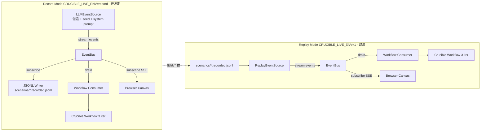
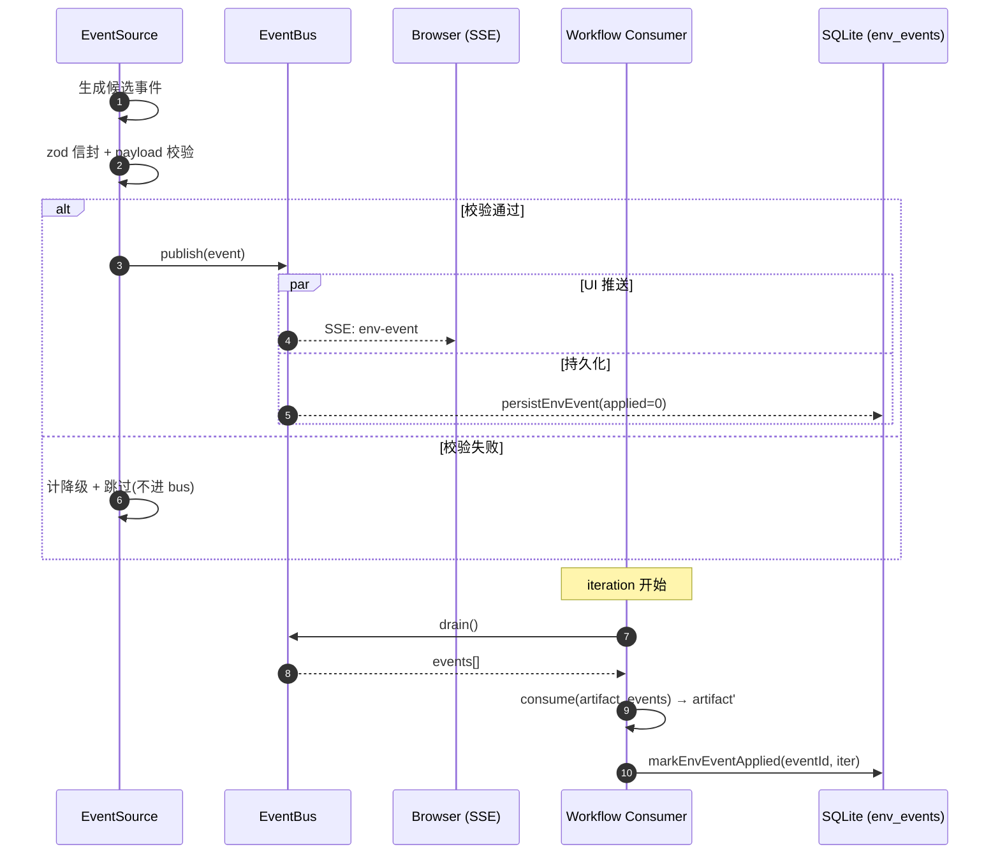
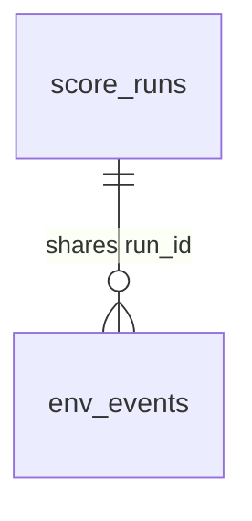
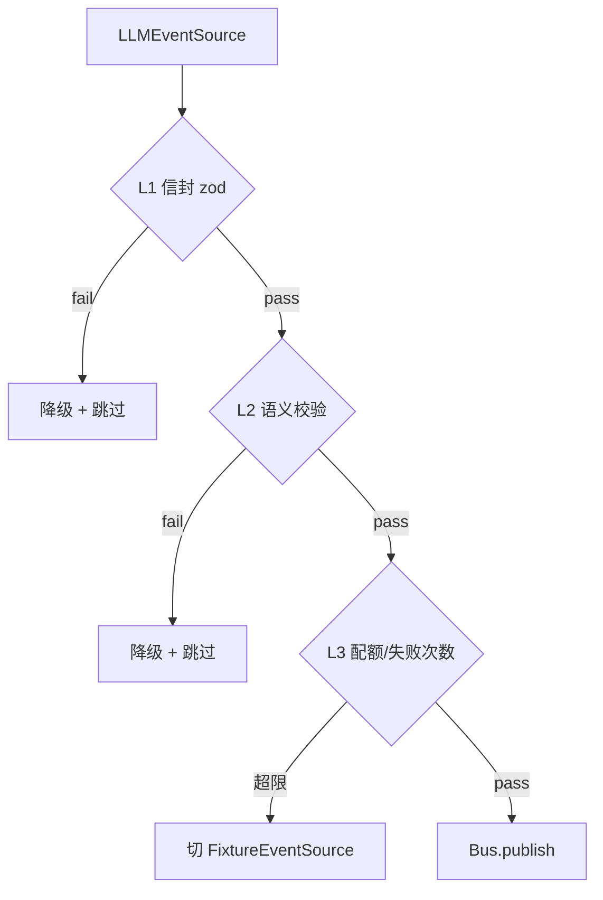

# Crucible Live Env — v1 Design Spec

> **Status**: Draft · pending writing-plans
> **Date**: 2026-06-30
> **Origin**: Brainstorming session triggered by MIRA Nature paper analysis
> (`references/articles/MIRA-medical-agent-nature.md` in `traveller.feature-beta`)
> **Predecessor**: P3.5 (SQLite + Mastra adapter + novelty v2 + golden-set governance)
> **Successor**: P+1 (Fast/Slow Model Tiering) — separate spec
> **Codename**: Crucible Live Env (`src/env/`)
> **PRD anchor**: 接 PRD v1.2 §3-§4(Fork + Multi-Agent Coordination)演化记录 **E7**

---

## 0. 编者前言

MIRA(Nature 2026)打动评委的不是"医疗模型更强",而是"**首次把诊疗工作抽象成可执行、
可评测、可扩展的 Agent 环境**"。对照 Crucible P3.5 现状,我们已经具备 MIRA 的"协议层
+ 连续决策 + 评测 harness"三件套,但**缺少 MIRA 的环境模拟器**——一个会"边走边吐
数据 / 边走边变规则"的世界,逼迫 multi-agent 在动态条件下做连续决策。

本 spec 描述 Live Env **v1**——刻意聚焦"路演 demo 动画场"形态(brainstorming Q1
锁定),但骨架必须能承接 v2(连续决策考场)/ v3(交互式 EHR)/ v4(ToB 审计轨迹)。

实现路径锁定 **A. Replay-First**(Q9):先打通 fixture → bus → workflow → UI 全流程,
最后再叠加 LLM EventSource,保证任何中间节点都能跑、能测、能演。

---

## §1 命名与定位

### 1.1 一句话定位

> **一个能"边走边吐事件"的浏览器可观测环境模拟器,让 Crucible 多智能体协同从'离线
> 打分'升级为'对动态世界的连续决策'——v1 以路演 demo 形态落地。**

### 1.2 三层语义扩写

- **协同伙伴**:不是新 agent,而是 agent 们要应对的世界
- **形态原型**:v1 长什么样,v2/v3/v4 就在它的骨架上长出来
- **零侵入**:env 模块不启用时,P3.5 所有行为原封不动

### 1.3 命名(对外)

- 模块名 → **Crucible Live Env**(否决"Disruption Theatre" / "MIRA-style Patient Agent")
- 模块根 → `src/env/`
- Spec 文件 → 本文件
- 演化记录节点 → **E7 · Crucible Live Env v1**

---

## §2 模块边界与文件布局

### 2.1 新增目录

```
src/env/
├── types.ts                      # Event 三谱 zod schema + EventSource 接口
├── constants.ts                  # 集中所有魔法数(§11.3)
├── event-bus.ts                  # 内存 pub/sub + drain + snapshot
├── event-source/
│   ├── replay.ts                 # JSONL 回放(v1 默认,demo 现场用)
│   ├── llm.ts                    # LLM 扮演(录制期用)
│   └── fixture.ts                # 极简降级源(L1/L2 失败兜底)
├── scenarios/
│   ├── travel-drift.yaml         # 第一幕:旅行 fixture(港 3 日)
│   ├── intel-drift.yaml          # 第二幕:情报表 fixture(BigSet 调研报告快照)
│   ├── travel-drift.recorded.jsonl    # LLM 录制产物
│   ├── intel-drift.recorded.jsonl
│   ├── travel-drift.fallback.jsonl    # 路演安全网
│   ├── intel-drift.fallback.jsonl
│   ├── travel-drift.record-stats.json # 录制 metrics(CI 检查)
│   └── intel-drift.record-stats.json
├── prompts/
│   └── llm-source.system.md      # LLM 录制 system prompt(git 跟踪)
├── consumer.ts                   # 事件折叠进 artifact(纯函数)
├── semantic-validator.ts         # L2 校验
├── http.ts                       # SSE / snapshot endpoints
└── index.ts                      # 公开 API: startLiveEnv() / EnvHandle

scripts/
└── run-live-env.mjs              # 启动器:env + workflow + 浏览器 demo

tests/env/   (镜像 src/env/,详见 §9)
```

### 2.2 现有模块的最小接触面(改动清单)

| 文件 | 改动 | 内容 |
|---|---|---|
| `src/workflow/crucible.ts` | **+ 30 行以内** | `CrucibleRunInput` 加可选 `liveEnv?: EnvHandle`;迭代循环开头加 5 行 consume;`CrucibleIteration` 加 `consumedEventIds` |
| `src/scorer/augmented.ts` | **+ 5 行以内** | 评估硬约束时优先读 `artifact.runtime_overrides[constraint.id]` |
| `src/persistence/sink.ts` | **+ 一个 sink 函数** | `persistEnvEvent` + `markEnvEventApplied` |
| `src/persistence/migrations/005_env_events.sql` | **新增** | 见 §7.2 |
| `src/contract/schema.ts` | **零改动** | Event 不进 contract |
| `scripts/run-demo-html.mjs` | **零改动** | demo:html 与 env:demo 是两个入口 |
| 现有 agents (scorer/critic/curator/...) | **零改动** | 它们只看 artifact,不知道 env 存在 |

### 2.3 启用开关

| 开关 | 默认 | 行为 |
|---|---|---|
| 不传 `liveEnv` 入参 | ✅ 默认 | P3.5 行为零变化(`npm test` 现有 485 全绿) |
| `CRUCIBLE_LIVE_ENV=1 --scenario=travel-drift` | 路演时 | replay 模式,从 `*.recorded.jsonl` 回放 |
| `CRUCIBLE_LIVE_ENV=record` | 录制期 | LLM EventSource,写入 `*.recorded.jsonl` |

### 2.4 边界纪律(明确不做)

- ❌ env 不写 artifact 的 `state[]`——只产事件,折叠逻辑集中在 `consumer.ts`
- ❌ env 不调 Scorer/Critic/Curator——纯数据源,只写不读
- ❌ env 不引 Express/Fastify——`http.ts` 用 `node:http`

---

## §3 数据模型

### 3.1 三谱 Event Schema(zod)

```ts
// src/env/types.ts
import { z } from 'zod';

const EventEnvelope = z.object({
  id: z.string().uuid(),
  scenario: z.string(),
  t_offset_ms: z.number().int().min(0),
  emitted_by: z.enum(['llm', 'replay', 'fixture']),
  // kind 由各 payload 自己 z.literal 声明,EventEnvelope 不声明 — 否则 zod merge
  // 时 envelope 的 enum 会被 payload 的 literal 覆盖,enum 那行属冗余。
});

const DisruptionPayload = z.object({
  kind: z.literal('disruption'),
  subject: z.string(),
  reason: z.string(),
  severity: z.enum(['minor', 'major', 'blocker']),
  invalidates: z.array(z.string()).default([]),
});

const InfoDropPayload = z.object({
  kind: z.literal('info_drop'),
  target_field: z.string(),
  target_locator: z.string(),
  new_value: z.unknown(),
  evidence: z.string(),
  source_trust: z.number().min(0).max(1),
});

const ConstraintUpdatePayload = z.object({
  kind: z.literal('constraint_update'),
  constraint_id: z.string(),
  new_threshold: z.unknown(),
  reason: z.string(),
});

export const LiveEnvEvent = z.discriminatedUnion('kind', [
  EventEnvelope.merge(DisruptionPayload),
  EventEnvelope.merge(InfoDropPayload),
  EventEnvelope.merge(ConstraintUpdatePayload),
]);
export type LiveEnvEvent = z.infer<typeof LiveEnvEvent>;
```

### 3.2 EventSource 接口

```ts
export interface EventSource {
  readonly name: 'llm' | 'replay' | 'fixture';
  stream(scenario: string, signal: AbortSignal): AsyncIterable<LiveEnvEvent>;
}
```

三个实现的差异仅在 `stream` 节奏控制——Replay 用 `setTimeout`、LLM 用流式 API、Fixture
全部立刻 yield。

### 3.3 EventBus 接口

```ts
export interface EventBus {
  publish(event: LiveEnvEvent): void;
  subscribe(handler: (e: LiveEnvEvent) => void): () => void;
  drain(): LiveEnvEvent[];          // workflow 轮间消费
  snapshot(): readonly LiveEnvEvent[];  // UI 重连补全
}
```

`drain` 与 `subscribe` 不互斥——读同一份内存 log,只是 drain 多维护未消费指针。

### 3.4 EnvHandle(对外 API)

```ts
export interface EnvHandle {
  bus: EventBus;
  scenario: string;
  runId: string;
  start(): Promise<void>;
  stop(): Promise<void>;
  consume(artifact: Artifact): { artifact: Artifact; appliedEventIds: string[] };
}

export function startLiveEnv(opts: {
  scenario: string;
  mode: 'replay' | 'record';
  fixturePath?: string;
}): Promise<EnvHandle>;
```

---

## §4 数据流(record / replay 双模)

### 4.1 双模总览



两路径完全同构——路演现场观众无法区分。

### 4.2 单事件生命周期



### 4.3 一场 60-90 秒 demo 示例(travel-drift)

| t_offset | kind | 内容 | Workflow 反应 |
|---|---|---|---|
| 0 s | — | buggy v1 → Iteration 1 | Scorer 找老 bug → Critic 补丁 |
| ~12 s | `disruption` minor | 尖沙咀下雨,室外节点要换 | drain → consume → elasticity=replaceable |
| ~20 s | — | Iteration 2,score↑ | |
| ~32 s | `info_drop` | 维港游船特价 ¥80 | drain → consume → 改 cost |
| ~45 s | `constraint_update` | 用户"今天只想走 6000 步" | drain → time_budget 阈值变化 |
| ~50 s | — | Iteration 3,score↑ | |
| ~80 s | — | 收敛,UI 显示分数轨迹 | |

### 4.4 异常路径

| 异常 | 兜底位置 | 行为 |
|---|---|---|
| LLM 返回非 JSON / zod 失败 | EventSource 内部 | 丢弃 + 降级计数 |
| JSONL 文件不存在(replay) | ReplayEventSource | 启动期 throw,fail-fast |
| SQLite 写失败 | Bus.subscribe handler | log warn 不打断 |
| SSE 客户端断开 | http.ts | 自动清理订阅 |
| Workflow 迭代抛错 | runCrucibleWorkflow 现有 try/catch | env 不感知 |

---

## §5 与 Workflow 接线

### 5.1 Workflow 改动总览(净增 ≤ 30 行)

```diff
 export interface CrucibleRunInput {
   ...
+  liveEnv?: EnvHandle;
 }

 export interface CrucibleIteration {
   ...
+  consumedEventIds: string[];
 }

 // 迭代循环开头:
+  let consumedEventIds: string[] = [];
+  if (input.liveEnv) {
+    const result = input.liveEnv.consume(currentArtifact);
+    currentArtifact = result.artifact;
+    consumedEventIds = result.appliedEventIds;
+  }

 // iteration push:
   allIterations.push({
     ...
+    consumedEventIds,
   });
```

### 5.2 consume() 折叠语义(三类事件)

```ts
// src/env/consumer.ts
export function consumeEvents(
  artifact: Artifact,
  events: LiveEnvEvent[]
): { artifact: Artifact; appliedEventIds: string[] };
```

| Event kind | 折叠目标 | 不可应用时 |
|---|---|---|
| `disruption` | `subject` 节点 state += invalidates;severity=blocker 时 elasticity → replaceable | subject 找不到 → unmatched 跳过 |
| `info_drop` | `target_field@target_locator = new_value`;同时写 `source`、`source_trust` | target_field 不在 contract.fields → 跳过 |
| `constraint_update` | 写 `artifact.runtime_overrides[constraint_id] = new_threshold`(**不动 contract**) | constraint_id 不在 contract.hard_constraints → 跳过 |

**绝不改 contract**——契约变更走 Human Gate,这是 PRD §6 三锚之一("人工闸门设在契约
变更,不拦数据流入")。

### 5.3 Scorer 最小适配

```diff
- const threshold = constraint.threshold;
+ const threshold = artifact.runtime_overrides?.[constraint.id] ?? constraint.threshold;
```

`runtime_overrides` 字段在 `Artifact` 类型加 optional,env 关闭时 undefined → fallback 到
`constraint.threshold` → P3.5 行为一致。

### 5.4 兼容性矩阵

| 场景 | `liveEnv` | `runtime_overrides` | 行为 |
|---|---|---|---|
| P3.5 老路径 | undefined | undefined | 完全等同今天 |
| env 开启 + 无事件 | 有 | 一直 undefined | 等价 P3.5 + 多走 no-op consume |
| env 开启 + 事件流 | 有 | 轮间写入 | 完整 demo 流程 |

---

## §6 UI 集成

### 6.1 在 demo-html.ts 五段式后追加第六段"Live Env"

```
┌─ §1-§5 五段式报告(P3.5 原样)──────────┐
└──────────────────────────────────────────┘
┌─ §6 Live Env(追加)─────────────────────┐
│ Scenario tabs: [Travel Drift] [Intel]    │
│ ┌─ Timeline ──┬─ Score ──────┐           │
│ │ • 0:12 ⚡   │ ╱╲ chart      │           │
│ │ • 0:32 ℹ    │               │           │
│ │ • 0:45 ⚙    │ 0.42 → 0.78  │           │
│ └─────────────┴───────────────┘           │
│ ┌─ Artifact diff(per consume)──────────┐│
│ │ iter 2: + node[2].state += "raining"  ││
│ └────────────────────────────────────────┘│
└──────────────────────────────────────────┘
```

### 6.2 SSE 协议(`src/env/http.ts`)

| Endpoint | 方法 | 作用 |
|---|---|---|
| `GET /env/snapshot?scenario=...` | 一次性 | `{ events, iterations }` 灌画布 |
| `GET /env/stream?scenario=...` | SSE | 推送 6 种 message type(§11.7) |

服务端 `node:http` 手写 `text/event-stream`,**不引 Express/Socket.io**;客户端
vanilla JS + `EventSource`,**不引前端框架**。

### 6.3 Live vs Static 双形态(P3.5 离线分享习惯不丢)

| 模式 | 启动 | 数据源 | 用途 |
|---|---|---|---|
| Live | `npm run env:demo` | SSE | 路演现场、开发期 |
| Static | `npm run env:demo:export` | JSONL **内嵌**到 HTML | 邮件分享、URL 托管 |

渲染代码两形态共用:`window.__EMBEDDED_EVENTS__` 存在则自播,否则订阅 SSE。

### 6.4 双幕切换

`/env?scenario=travel-drift` ↔ `/env?scenario=intel-drift`——**整页刷新**,无 SPA
router,服务端 stop 旧 EnvHandle、启动新的、清空 bus snapshot。

### 6.5 降级

| 场景 | 行为 |
|---|---|
| 浏览器不支持 EventSource | 退回 5s 轮询 `/env/snapshot` |
| SSE 断线 | 浏览器原生重连 + 补 snapshot |
| JS 禁用 | 仅五段式静态报告 + 提示 |

---

## §7 持久化与审计

### 7.1 现状盘点

| 现有表 | env 是否触碰 |
|---|---|
| `contracts` / `score_runs` / `ab_results` / `proposals` | ❌ 不动 schema |
| **`env_events`** *(新增)* | ✅ 新表 |

### 7.2 `env_events` 表结构(`migrations/005_env_events.sql`)

```sql
CREATE TABLE IF NOT EXISTS env_events (
  id           TEXT PRIMARY KEY,           -- LiveEnvEvent.id (uuid)
  run_id       TEXT NOT NULL,              -- 关联 score_runs.run_id
  scenario     TEXT NOT NULL,
  kind         TEXT NOT NULL CHECK (kind IN ('disruption','info_drop','constraint_update')),
  emitted_by   TEXT NOT NULL CHECK (emitted_by IN ('llm','replay','fixture')),
  t_offset_ms  INTEGER NOT NULL,
  payload_json TEXT NOT NULL,
  applied      INTEGER NOT NULL DEFAULT 0, -- 0/1
  applied_iter INTEGER,                    -- NULL = 未消费
  created_at   TEXT NOT NULL DEFAULT (datetime('now')),
  actor_id     TEXT
);

CREATE INDEX IF NOT EXISTS idx_env_events_run_id   ON env_events(run_id);
CREATE INDEX IF NOT EXISTS idx_env_events_scenario ON env_events(scenario, created_at);
```

### 7.3 两次写入策略

- **publish 时**:`persistEnvEvent` 落 row,`applied=0`
- **consume 真折叠后**:`markEnvEventApplied` 回填 `applied=1, applied_iter=i`

这样审计能看到"环境吐过、但被忽略"的事件——MIRA 论文未做到这一层。

### 7.4 runId 串联



一条 SQL 拉完整剧本:

```sql
SELECT e.t_offset_ms, e.kind, e.applied, e.applied_iter, s.iteration, s.final_score
FROM env_events e
LEFT JOIN score_runs s ON s.run_id = e.run_id AND s.iteration = e.applied_iter
WHERE e.run_id = ? ORDER BY e.t_offset_ms;
```

### 7.5 audit-trail 导出扩展

`scripts/audit-trail-export.ts` 加可选段:有 `env_events` 表才输出,**老报告格式向后
兼容**。

### 7.6 降级矩阵

| 场景 | 处理 |
|---|---|
| SQLite 写失败 | log warn,事件留内存,UI 不感知 |
| `CRUCIBLE_DB_PATH` 未设 | env 也尊重,不落库 |
| `:memory:` DB(测试) | 全套支持,无文件副作用 |

---

## §8 安全网

### 8.1 三层防御



| 层 | 触发 | 后果 | demo 现场感知 |
|---|---|---|---|
| L1 信封 | zod 失败 | 单条丢 | 听众无感 |
| L2 语义 | subject/locator/constraint 不存在 | 单条丢 | 听众无感 |
| L3 配额 | > 8 事件或连续 3 次失败 | 切到 fallback fixture | 节奏微变,demo 不断 |

### 8.2 LLM 录制控制(3 个 constants + 1 个 SDK 参数)

| 控制 | 取值 | 归属 | 理由 |
|---|---|---|---|
| temperature | **0.3** | `ENV_CONST.LLM_TEMPERATURE` | 0 触发贪婪解码 bug |
| seed | **42**(写死) | `ENV_CONST.LLM_SEED` | 录制可复现 |
| system_prompt | 文件 `src/env/prompts/llm-source.system.md` | `ENV_CONST.LLM_SYSTEM_PROMPT_PATH` | git 跟踪,改 = PR review |
| response_format | `json_object` / `json_schema` | 直接传 OpenAI SDK,**不进 constants** | 把 L1 失败压到接近 0 |

录制时 metrics 落 `scenarios/{scenario}.record-stats.json`,**L1 失败 > 0 的录制不允许
commit**(CI 闸门)。

### 8.3 现场预案

| 灾难 | 现场操作 |
|---|---|
| 笔记本断网 | demo 已是 replay 模式,**不需要网** |
| 浏览器崩溃 | 浏览器原生重连;实在不行用 `env:demo:export` 单文件 |
| Workflow 卡死 | env 服务端 90s watchdog 强发 disruption(blocker)收敛 |
| 听众问"换模型" | 拒绝,诚实回答"录播,模型切换在 record 模式做" |

### 8.4 v1 不解决项(对应 `agents.md` CAVEAT-001)

⚠️ **L1/L2 校验通过 ≠ 事件有意义**——LLM 可吐出语法合法但叙事无聊(同节点重复
disruption、字段抖动、无戏剧推动)。

**v1 应对**:录制期人工 review 录制产物,不满意就重录,**不能把"L1/L2 通过"等同于
"可以 commit"**。详见 `D:\Apps\traveller.feature-beta\agents.md` CAVEAT-001。

⚠️ **Fallback fixture 自身的剧情质量**也需要维护——它是 LLM 录制产物的简化版,演员
台词不能太走样。`§10 G3.4` 验收要求每次改 scenario fixture,fallback 同步更新。

---

## §9 测试策略

### 9.1 四层金字塔

```
┌──────────────────┐
│ E2E (3-5)        │
├──────────────────┤
│ 集成 (10-15)     │
├──────────────────┤
│ 契约 (8-12)      │
├──────────────────┤
│ 单元 (50-70)     │
└──────────────────┘
```

总量目标 ~80 测试,vitest 总耗时 ≤ 3 秒。

### 9.2 单元层(用 fake timer)

| 文件 | 关键点 | 估计 |
|---|---|---|
| `tests/env/types.test.ts` | 三谱 schema 通过/失败用例 | 12 |
| `tests/env/event-bus.test.ts` | publish/subscribe/drain/snapshot/unsubscribe | 10 |
| `tests/env/event-source/replay.test.ts` | fake timer + AbortSignal + JSONL 缺失 | 8 |
| `tests/env/event-source/llm.test.ts` | mock LLM stream + L1/L3 切换 | 10 |
| `tests/env/event-source/fixture-fallback.test.ts` | 顺序保持 | 4 |
| `tests/env/consumer.test.ts` | 三类折叠 + unmatched + appliedEventIds | 12 |
| `tests/env/semantic-validator.test.ts` | 三类不存在的拒绝 | 6 |
| `tests/env/http.test.ts` | SSE 头部 + 心跳 + Abort 清理 | 6 |

### 9.3 契约层(防 fixture/replay 漂移)

- `tests/env/scenarios/*.fixture.test.ts` × 2 幕
- `tests/env/scenarios/recorded.test.ts`(行级 zod + t_offset_ms 单调)
- `tests/env/scenarios/fallback-parity.test.ts`(三类事件至少各 1)
- `tests/env/scenarios/recorded-quality.test.ts`(stats.l1Failures = 0)
- `tests/env/contract-coverage.test.ts`(每条 hard_constraint 至少一个事件覆盖)

### 9.4 集成层(env + workflow + persistence)

| 场景 | 断言 |
|---|---|
| A. 无 env 入参 | 行为逐字段等于 P3.5 黄金对照 |
| B. env replay + 0 事件 | 等价 A |
| C. env replay + 3 事件 | applied_iter 落库 + 分数轨迹符合预期 |
| D. consume 失败(subject 不存在) | applied=0 落库 + workflow 不影响 |
| E. runtime_overrides 路径 | constraint_update 改 time_budget → Scorer 真用新阈值 |
| F. SQLite 不可写 | env 不 crash,事件留内存 |
| G. CRUCIBLE_DB_PATH 未设 | env 不写库,workflow 正常 |
| H. 双幕切换 | stop 时 bus snapshot 清空 |

### 9.5 E2E 层(不调真实 LLM)

| ID | 场景 | 断言核心 |
|---|---|---|
| E2E-1 | travel-drift replay 全 3 轮 | 单调递增 + ≥ 2 事件消费 |
| E2E-2 | intel-drift replay 全 3 轮 | 同上 + 双幕兼容 |
| E2E-3 | travel-drift + SQLite | env_events 行数 = 事件数 |
| E2E-4 | 早收敛(提升 < 0.01) | iter 2 提前停 |
| E2E-5 | LLMEventSource mocked + record | 写 JSONL + 与 replay 同分数 |

### 9.6 浏览器侧不自动化

- ✅ 服务端 SSE 协议:单测
- ❌ 浏览器 DOM 渲染:**手测清单 `docs/qa/handtest-live-env.md`**
- 不引 Playwright/JSDOM(违"轻依赖"哲学),v2 再升级

### 9.7 LLM 录制 CI 闸门

```ts
test('all recorded.jsonl files have 0 L1/L2 failures', () => {
  for (const sc of ['travel-drift','intel-drift']) {
    const stats = readJSON(`src/env/scenarios/${sc}.record-stats.json`);
    expect(stats.l1Failures).toBe(0);
    expect(stats.l2Failures).toBe(0);
  }
});
```

### 9.8 不做的测试

- ❌ LLM 实际输出质量(叙事问题,见 CAVEAT-001)
- ❌ UI 视觉(无 Playwright)
- ❌ 网络延迟 / 跨域(localhost only)
- ❌ LLM provider 切换(沿用 `OPENAI_BASE_URL`)

### 9.9 覆盖率目标

| 模块 | 行覆盖 |
|---|---|
| types.ts | ≥ 95% |
| event-bus.ts | ≥ 90% |
| event-source/replay.ts | ≥ 85% |
| event-source/llm.ts | ≥ 80% |
| consumer.ts | ≥ 90% |
| semantic-validator.ts | ≥ 95% |
| http.ts | ≥ 70% |
| **整体** | **≥ 85%** |

---

## §10 验收清单(v1 完工硬性 checklist)

### 10.1 G1 代码基线

- G1.1 typecheck 退出码 0
- G1.2 `workflow/crucible.ts` 新增行数(`git diff main` 中的 `+` 行数,不含删除)≤ 30
- G1.3 `scorer/augmented.ts` 新增行数(同口径)≤ 5
- G1.4 `005_env_events.sql` 在 `:memory:` DB 幂等
- G1.5 零新增 npm 运行时依赖

### 10.2 G2 测试基线

- G2.1 现有 485 测试 100% 保留全绿
- G2.2 env 新增测试 ≥ 70
- G2.3 env 行覆盖 ≥ 85%
- G2.4 `npm test` 总耗时 ≤ 3 秒
- G2.5 5 个 E2E 全绿

### 10.3 G3 契约基线

- G3.1 两幕 fixture 契约测试全绿
- G3.2 两幕 `*.recorded.jsonl` 存在 + zod + 单调
- G3.3 两幕 `record-stats.json` 中 `l1Failures = l2Failures = 0`
- G3.4 两幕 `*.fallback.jsonl` 存在 + 三类事件各 1
- G3.5 现有 3 份 contract 零改动

### 10.4 G4 路演基线

- G4.1 `env:demo travel-drift` 断网跑通
- G4.2 `env:demo intel-drift` 断网跑通
- G4.3 `env:demo:export` 单文件 .html 三浏览器打开自动回放
- G4.4 切幕 < 5 秒重灌
- G4.5 SSE 断 5 秒重连无缺帧
- G4.6 30 秒 .gif/.mp4 录屏归档到 `references/demo-clips/`

### 10.5 G5 文档基线

- G5.1 本 spec commit
- G5.2 `docs/qa/handtest-live-env.md` commit
- G5.3 `agents.md` CAVEAT-001 仍在
- G5.4 `README.md` 加"Live Env demo"段
- G5.5 PRD 演化记录追加 **E7**

### 10.6 软指标(参考,不阻塞)

| 指标 | v1 目标 |
|---|---|
| 录制单场 LLM tokens | < 8K |
| 录制端到端时长 | < 90s |
| Replay 模式 tokens | 必 0 |
| `env_events` 单场行数 | 3-6 |
| UI 首屏 → 第一帧 | < 500 ms |

### 10.7 v1 显式不交付

- ❌ 真实 LLM 实时驱动路演
- ❌ 多人协作 UI
- ❌ 第三幕(financial 场景)
- ❌ 跨设备 SSE
- ❌ Playwright/JSDOM 自动化
- ❌ Patient Agent 自由问答
- ❌ 快慢模型分层(P+1)
- ❌ env_events 可视化查询 UI

### 10.8 风险登记

| 风险 | 触发 | 降级 |
|---|---|---|
| LLM 录制 stats 持续 > 0 | 三次重录失败 | 接受 fallback 为唯一源,LLMEventSource v1 不上 |
| `*.recorded.jsonl` > 100KB | 体积失控 | 收紧到 60s |
| better-sqlite3 编译失败 | 某 OS/Node | 沿用 `:memory:` 降级 |
| 现场断网 + 录制缺失 | 同时发生 | 回退 P3.5 五段式静态 |

### 10.9 验收会议清单(交付前 30 分钟)

1. G1-G5 五大门禁是否全绿?
2. 路演主备机两台是否都跑通 `env:demo`?
3. 备份 `env:demo:export` 单文件 .html 是否能离线打开?
4. 30 秒 .gif 是否挂上幻灯片?
5. agents.md CAVEAT-001 是否被路演主讲人口头复述?

---

## §11 命名 & 杂项决策(集中固化)

### 11.1 模块文件名(对齐 §2)

| 范畴 | 名称 |
|---|---|
| 对外名 | Crucible Live Env |
| 模块根 | `src/env/` |
| 测试根 | `tests/env/` |
| Spec | `2026-06-30-crucible-live-env-design.md` |
| 手测 | `docs/qa/handtest-live-env.md` |
| 演化节点 | **E7 · Crucible Live Env v1** |

### 11.2 环境变量(3 个,刻意少)

| 变量 | 取值 | 默认 |
|---|---|---|
| `CRUCIBLE_LIVE_ENV` | `1` / `record` / 未设 | 未设 |
| `CRUCIBLE_LIVE_ENV_SCENARIO` | `travel-drift` / `intel-drift` | 必填 |
| `CRUCIBLE_LIVE_ENV_PORT` | port | `5173` |

刻意没有:`SEED`(写死)、`TEMP`(写死)、`MODEL`(沿用 `OPENAI_MODEL`)。

### 11.3 常量(`src/env/constants.ts`)

```ts
export const ENV_CONST = {
  LLM_TEMPERATURE: 0.3,
  LLM_SEED: 42,
  LLM_SYSTEM_PROMPT_PATH: 'src/env/prompts/llm-source.system.md',
  MAX_EVENTS_PER_SCENARIO: 8,
  MAX_CONSECUTIVE_FAILURES: 3,
  SCENARIO_TIMEOUT_MS: 90_000,
  WORKFLOW_WATCHDOG_MS: 90_000,
  SSE_HEARTBEAT_MS: 15_000,
  SSE_RECONNECT_HINT_MS: 3_000,
  EVENT_TABLE: 'env_events',
} as const;
```

### 11.4 Scenario id 规范

- kebab-case 后缀 `-drift`
- 当前:`travel-drift` / `intel-drift`
- 未来:`<artifact-family>-drift`
- 与 contract 文件名解耦(env 是消费者,不渗版本号)

### 11.5 Event id

- uuid v4(`crypto.randomUUID()`)
- 由 EventSource 生成,下游不重发
- Replay 直接读 JSONL 既有 id
- **不许自增整数**

### 11.6 npm scripts

```json
{
  "demo:html": "node scripts/run-demo-html.mjs",
  "env:demo": "node scripts/run-live-env.mjs",
  "env:demo:export": "node scripts/run-live-env.mjs --export",
  "env:record": "CRUCIBLE_LIVE_ENV=record node scripts/run-live-env.mjs"
}
```

所有 demo 默认 `travel-drift`,`--scenario=intel-drift` 切换;默认 port 5173 可 `--port`
覆盖。

### 11.7 SSE message type(6 种,v1 不再加)

| type | 内容 | 时机 |
|---|---|---|
| `env-event` | `LiveEnvEvent` | 事件 publish |
| `iteration` | `{ index, scoreBefore, scoreAfter, consumedEventIds }` | 每轮结束 |
| `score` | `{ iter, score, violations }` | iteration 完成后 |
| `meta` | `{ scenario, runId, startedAt }` | 连接首帧 |
| `heartbeat` | 空 | 每 15 秒 |
| `done` | `{ reason, finalScore? }` | scenario 终止 |

### 11.8 SQLite 命名

- 表名:`env_events`(snake_case 复数)
- 主键:`id TEXT`(uuid)
- 外键:`run_id` 关联 `score_runs.run_id`,**不加 FK 约束**(项目惯例)
- 时间戳:`created_at TEXT DEFAULT (datetime('now'))`

### 11.9 文档语言

- Spec / PRD / agents.md / CAVEAT → 中文
- 代码注释 → 中英皆可,简短为先
- Console log → 英文短句
- README 段 → 中文为主,命令/路径英文
- Git commit message → 英文 imperative

### 11.10 提交策略

| 类目 | 提? |
|---|---|
| `src/env/**/*.ts` 源 | ✅ |
| `scenarios/*.yaml` | ✅ |
| `scenarios/*.recorded.jsonl` | ✅(过 §10 G3.3) |
| `scenarios/*.record-stats.json` | ✅(CI 依赖) |
| `scenarios/*.fallback.jsonl` | ✅ |
| `tests/env/**/*.test.ts` | ✅ |
| 本 spec | ✅ |
| `docs/qa/handtest-live-env.md` | ✅ |
| `.env` / API keys | ❌ |
| `*.recorded.jsonl.tmp` / coverage | ❌(gitignore) |
| 录屏 .gif / .mp4 | ✅(视体积 LFS 或 references/) |

---

## 附录 A · 与 PRD v1.2 演化记录的对接(已落地)

演化记录 **E7 · Crucible Live Env v1** 已追加到 PRD:
`D:\Apps\traveller.feature-beta\crucible prd1.0 - 1.2（new）.md` 文末"Evolution Log"段。

E7 内容(摘录自 PRD):

> | **E7** | **MIRA 启发 → Crucible Live Env v1** | 引入"边走边吐事件"的环境模拟器
> (`src/env/`),把多智能体协同从"离线打分"升级为"对动态世界连续决策";v1 形态聚焦
> 路演 demo 动画场,采 **Replay-First** 落地路径(先骨架后 LLM);双幕 `travel-drift` /
> `intel-drift` 同时验证跨族 DSL 不断裂(部分回答 OQ-13) | **把 MIRA 的"Agent 环境"
> 形态化为 Crucible 的可执行模块,同时为 v2(连续决策考场)/ v3(交互式 EHR)/ v4(ToB
> 审计轨迹)留出生长骨架** |

并在 PRD §6 多智能体章节追加(以 E7 子节形式):

> Live Env 不是新 agent,**是 agents 们要应对的世界**。它通过事件总线把外部漂移注入
> Workflow,但仍然遵守"契约不可改、Human Gate 仲裁标准"的三锚纪律——`constraint_update`
> 事件写入 artifact 的 `runtime_overrides`,**绝不污染 contract 本体**。

PRD 的 E7 子节同时显性引用了本 spec 路径与本 spec 附录 B 引用的 CAVEAT-001。

## 附录 B · 与 agents.md 的对接(已落地)

本 spec 已被 `agents.md` CAVEAT-001 引用作为来源。

`D:\Apps\traveller.feature-beta\agents.md` 的两块内容已同步本 spec:

1. **§1 目录角色**:已更新为"feature-beta = 跨 phase 战略层;crucible-dev = 代码 +
   phase 绑定的实施 spec",本 spec 落在 crucible-dev 符合"与某次实施紧耦合"的判定
   启发式。
2. **§2 CAVEAT-001**:Live Env v1 "LLM 事件语法合法 ≠ 叙事有意义" 缺陷,来源指针
   指向本 spec §8.4。

未来若 §8.4 提到的两项"v1 不解决"被升级解决,**应同时更新 CAVEAT-001 标记为"已解决"
并指向解决方案 spec**(对应 agents.md 维护规则 §3)。

---

## 下一步

1. ✅ Spec 写完(本文件)
2. ✅ Spec 自审(占位 / 一致性 / 范围 / 歧义)— 3 处歧义已修
3. ✅ 附录 A 同步 — PRD E7 已落地
4. ✅ 附录 B 同步 — agents.md CAVEAT-001 / §1 已对齐
5. ⏳ 用户审阅本 spec
6. ⏳ 转交 **writing-plans skill** 生成实现计划
